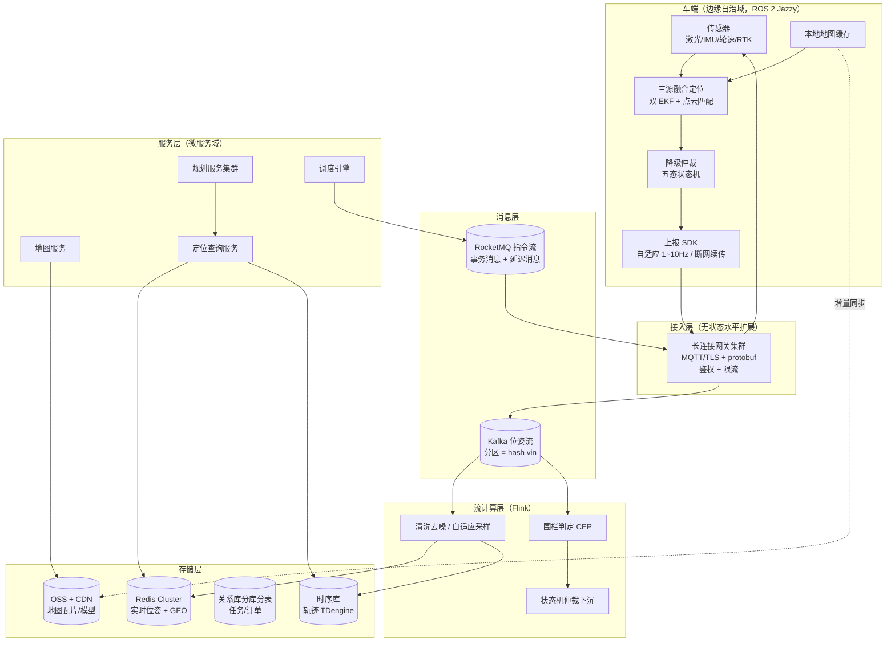

# campus-nav

校园低速自动驾驶车的**导航定位平台**：车端实时定位系统 + 云端高并发位置服务，中间件设计按**十万级终端**的规模选型（对标美团 / 饿了么配送定位体系的量级），架构上保留向百万级终端的水平扩展路径。

- **车端**：ROS 2 Jazzy + Nav2 + Gazebo Harmonic（Ubuntu 24.04 LTS），三源融合定位 + 边缘自治
- **云端**：长连接网关 + Kafka 位姿流 + Flink 实时计算 + Redis GEO / 时序库 / 分库分表（单元化多活）
- **当前状态**：**架构设计已完成（docs/ 齐套），代码未开工**——车端为包骨架（TODO 占位），云端为设计占位目录；实现顺序见 [architecture.md](docs/architecture.md) §8 演进路线（A0 架构 → A1 车端 → A2 云端地基 → A3 平台化）
- **需求来源**：[docs/requirements/导航定位模块.pdf](docs/requirements/导航定位模块.pdf) ｜ 详细设计：[docs/architecture.md](docs/architecture.md)

---

## 1. 量级目标（设计容量）

所有中间件选型与参数以下表为设计输入：

| 指标 | 设计容量 | 说明 |
| --- | --- | --- |
| 接入终端 | 10 万+ 长连接 | 可水平扩展至百万，网关无状态 |
| 位姿上报 | 峰值 50 万 msg/s | 自适应上报频率 1~10 Hz × 终端数 |
| 指令 / 任务下发 | 峰值 5 万 TPS | 可靠投递 + 幂等 + 租约 |
| 实时围栏 / 就近查询 P99 | < 20 ms | Redis GEO + 内存态 |
| 位姿端到端时延（上报 → 可查询） | P99 < 1 s | 接入 → 流处理 → 存储全链路 |
| 可用性 | 99.99% | 单元化部署 + 异地多活 |
| 轨迹数据留存 | 热 90 天 + 冷归档 | 时序库 TTL + 对象存储归档 |

---

## 2. 总体架构



---

## 3. 中间件设计（按量级选型）

### 3.1 接入层：长连接网关集群

| 决策点 | 方案 | 量级依据 |
| --- | --- | --- |
| 协议 | MQTT over TLS + protobuf 载荷 | 弱网友好、报文小（位姿帧 < 100 B） |
| 网关实现 | 自研 Netty 网关或 EMQX 企业集群 | 单实例 10 万连接 × 32+ 实例，无状态可水平扩 |
| 鉴权 | 设备证书 + 短期 token，连接时一次校验 | 避免每条消息鉴权开销 |
| 限流 | Sentinel 接入侧限流 + 终端自适应上报 | 洪峰削峰在边缘完成 |
| 会话保持 | 网关不存业务状态，连接路由表入 Redis | 任意网关可服务任意终端 |

### 3.2 消息层：双队列分工

| 队列 | 用途 | 关键设计 |
| --- | --- | --- |
| **Kafka**（位姿流） | 上报数据主通道 | **分区 = hash(vin)**，保证单车消息有序；按分区扩消费并行度；保留 7 天供回放 |
| **RocketMQ**（指令流） | 任务/指令下发 | 事务消息保证"本地落库 + 投递"原子性；**延迟消息实现派发租约超时**（替代轮询）；重试队列 + 死信 |

### 3.3 流计算层：Flink

| 作业 | 职责 | 说明 |
| --- | --- | --- |
| 清洗去噪 | 位姿合法性校验、跳变剔除、自适应采样 | 下游存储只见到可信数据 |
| 围栏判定 CEP | 退化区/地理围栏命中检测（多边形 + GeoHash 预过滤） | 规则热更新（Nacos 推送） |
| 状态机仲裁 | 五态降级状态机的云端镜像 | 车端自治优先，云端兜底对账 |
| 异常检测 | 轨迹漂移、长时间静止、离线检出 | 输出告警到通知服务 |

### 3.4 存储层：四类存储各司其职

| 存储 | 数据 | 关键设计 |
| --- | --- | --- |
| **Redis Cluster** | 实时位姿（Hash）+ 空间索引（GEO）+ 分布式锁/租约 | `GEOPOS/GEOSEARCH` 做就近查询 P99 < 20 ms；key 按城市分槽 |
| **时序库（TDengine / ClickHouse）** | 位姿轨迹 | 列存压缩 ~10:1，按天分区，TTL 90 天，冷数据归档 OSS；轨迹回放/误差评估直接 SQL |
| **关系库（PostgreSQL + ShardingSphere）** | 任务、订单、授权、组织 | 分库分表键 = `org_id`（租户隔离与查询模式一致） |
| **OSS + CDN** | 地图瓦片、venue 文件、模型 | 边缘节点 CDN 分发，车端增量同步（断点续传复用分片机制） |

### 3.5 单元化与多活（99.99% 的来源）

- **Set 化部署**：按城市/区域切分单元，单元内"接入-消息-计算-存储"闭环，跨单元只同步元数据（组织/账户）
- **异地多活**：同城双机房 + 异地灾备，单元可整体切换
- **无状态优先**：网关、微服务全部无状态，状态收敛到 Redis/时序库，任意节点可替换

### 3.6 可观测与治理

| 维度 | 选型 | 用途 |
| --- | --- | --- |
| 指标 | Prometheus + Grafana | QPS/时延/积压/连接数，按单元聚合 |
| 链路 | OpenTelemetry / SkyWalking | 位姿全链路 trace（网关 → Kafka → Flink → 存储） |
| 日志 | ELK | 结构化 JSON（trace_id、vin、city、unit） |
| 限流熔断 | Sentinel | 接入限流、外部依赖（高德）熔断 |
| 注册配置 | Nacos + Apollo | 服务发现；围栏规则/降级开关热推送 |

---

## 4. 核心设计

### 4.1 坐标转换链（四层，全系统的地基）

```
高德 GCJ-02 ──(官方转换 API，开源算法兜底)──▶ WGS84
            ──(GeographicLib LocalCartesian，datum 来自 map.json)──▶ ENU（米制）
            ──(map.json：原点平移 + 基准朝向旋转)──▶ map 系（城市/园区级工作系）
```

- map 系是唯一的对内工作坐标系；GCJ-02 只出现在外部 API 边界，内部禁止传播
- 每次转换带**残差与来源标记**（`amap_api | public_algo`），误差可归因
- 坐标服务为**纯函数库 + 无状态服务**双形态：车端内嵌 C++ 库，云端部署为 gRPC 服务（水平扩容）
- 全链路闭合误差验收 **< 0.1 m**（已知控制点往返），作为坐标服务单测门禁

### 4.2 数据资产：map.json（单一事实来源）

一个 JSON 服务五方：车端坐标库 datum、建图对齐锚点、仲裁服务退化区规则（地理围栏）、云端地图元数据、时序库按 map_id 切分的分析维度。

```json
{
  "map_id": "hohai-campus-v1",
  "version": "2026.11.30-rc1",
  "datum":     { "wgs84": { "lat": 31.8639, "lon": 118.6080, "alt": 12.4 }, "heading_deg": 87.3 },
  "anchors":   [ { "id": "gcp-01", "wgs84": { "lat": 31.8641, "lon": 118.6083 },
                   "map_xy": [23.45, -8.12], "residual_m": 0.04 } ],
  "grid":      { "pgm": "map.pgm", "yaml": "map.yaml", "resolution_m": 0.05 },
  "problem_scenes": [ { "id": "scene-wutong", "type": "gnss_denied",
                        "polygon_map_xy": [[0,0]] } ],
  "accuracy":  { "anchor_rmse_m": 0.06, "method": "helmert_similarity" }
}
```

版本规则：锚点 RMSE < 0.15 m 才允许发布；发布后版本不可变，改图出新版本；地图分发走 **OSS + CDN + 车端增量同步**（分片断点续传）。

### 4.3 双链冗余 + 两级降级

**车端（边缘自治）**——弱网/断网必须本地闭环：

| 链 | 输入 | 角色 |
| --- | --- | --- |
| 局部链 `ekf_local` | 轮速 + IMU，50 Hz 连续递推 | 主链：保连续性 |
| 全局链 `ekf_global` | 点云匹配 + RTK 校正 | 备链：纠漂移 |

车端仲裁五态：`NOMINAL → GNSS_DEGRADED → SCAN_LOST → DEAD_RECKONING → LOST`（触发条件与行为见 [docs/architecture.md](docs/architecture.md) §5.2）。断网时本地持续输出位姿并缓存上报数据，恢复后增量补传——**车端自治是第一道降级**。

**云端（平台兜底）**——仲裁状态机在 Flink 侧镜像运行：终端状态与云端对账不一致时以云端为准触发指令（要求停车/遥控接管），告警进通知服务。

### 4.4 可靠投递与幂等（指令链路）

- 指令带全局唯一 `seq`（单车单调递增），终端乱序/重复直接丢弃
- 下发走 RocketMQ 事务消息：任务落库与消息投递原子
- 派发租约用**延迟消息**实现超时（不轮询数据库），租约内未 ACK 进入人工兜底队列
- 全链路 trace_id 贯穿（网关 → Kafka → Flink → 存储 → 终端 ACK）

### 4.5 外部依赖治理（高德 API）

- 官方转换 API 为主（合规），开源算法兜底，双实现交叉校验出报告
- Sentinel 熔断 + 本地缓存；mock 模式供 CI，不打真接口
- 降级预案：API 不可用时仅接受本地目的地（车道图直达）

---

## 5. 模块

**车端（本仓库，ROS 2 colcon 工作空间）**

| 包 | 类型 | 职责 |
| --- | --- | --- |
| `campus_msgs` | 接口 | 消息契约：`LocalizationStatus`（五态+协方差）、`MapMeta` |
| `campus_coord` ★ | 自研 C++ | 坐标服务：GCJ-02 双实现、LocalCartesian、Helmert、map.json 读写 |
| `campus_map_tools` ★ | 自研 Python | 建图管道：RTK 锚点采集、对齐报告、栅格出图 |
| `campus_localization` ★ | 自研 C++ | 三源融合定位 + 五态降级仲裁 |
| `campus_planning` ★ | 自研 Python | 规划网关：高德客户端（mock）/ 坐标转换 / goal_server |
| `campus_bringup` | 组装 | 部署编排：仿真 / 建图 / 实车 launch、URDF |
| `campus_gz_sim` | 仿真 | 测试环境：噪声注入（multipath）、ros_gz 桥接 |

**云端域服务（[cloud/](cloud/)，设计文档 [docs/services/](docs/services/)）**

| 服务 | 职责 | 中间件 |
| --- | --- | --- |
| 接入网关 | 长连接管理、鉴权限流 | Netty/EMQX、Sentinel、Redis |
| 位姿管道 | 清洗 / 围栏 / 仲裁镜像 / 落库 | Kafka、Flink、Redis Cluster、TDengine |
| 地图服务 | 地图资产、版本、分发 | PostgreSQL、OSS + CDN、Nacos |
| 定位查询服务 | 实时位置 / 轨迹 / 就近查询 API | Redis GEO、时序库 |
| 规划服务集群 | 路径规划 / ETA | gRPC 微服务、本地缓存 |
| 调度引擎 | 任务-车辆匹配、租约、兜底 | RocketMQ 事务消息、ShardingSphere 分库分表 |

```
campus-nav/
├── docs/                       # ★ 架构先行（架构必须设计完才写代码）
│   ├── architecture.md         #   总体架构（量级目标/域划分/时延预算/演进路线）
│   ├── middleware.md           #   中间件详细设计（选型参数/容量/分区/分片）
│   ├── contracts.md            #   数据与接口契约（protobuf/Kafka/Redis/gRPC/REST）
│   ├── adr.md                  #   架构决策记录（10 条）
│   ├── vehicle-architecture.md #   车端域详细架构（ROS 2）
│   └── services/               #   六个云端域服务设计（gateway/pipeline/map/query/planning/dispatch）
├── vehicle/                    # 车端域：七个 colcon 包（见 vehicle/README.md）
├── cloud/                      # 云端域：六个服务（设计阶段占位，各 README 指向设计文档）
├── deploy/                     # 本地中间件栈（与生产同构契约）
├── maps/                       # 地图资产（三件套，pgm 走 LFS）
└── tools/                      # 质量门禁：误差评估 / PlotJuggler / 仿真回归
```

---

## 6. 技术栈

| 层 | 车端 | 云端 |
| --- | --- | --- |
| 运行时 | ROS 2 Jazzy / C++17 / Python 3 | JVM（Spring Cloud）/ gRPC / K8s + HPA |
| 接入 | MQTT 客户端（TLS + protobuf） | Netty 网关 / EMQX 集群 |
| 消息 | 断网续传队列 | Kafka（位姿流）、RocketMQ（指令流） |
| 计算 | 双 EKF / AMCL / 行为树 | Flink（清洗 / CEP / 仲裁镜像） |
| 存储 | 本地地图缓存 + SQLite 队列 | Redis Cluster / TDengine / PostgreSQL 分库分表 / OSS |
| 定位内核 | AMCL + robot_localization + NTRIP RTK | Redis GEO / 就近查询 API |
| 观测 | PlotJuggler / 本地日志 | Prometheus / OpenTelemetry / ELK |
| 治理 | 降级仲裁（五态） | Sentinel / Nacos / Apollo / 单元化多活 |

---

## 7. 构建与运行

```bash
# 车端依赖
sudo apt install ros-jazzy-desktop ros-jazzy-nav2-bringup \
  ros-jazzy-slam-toolbox ros-jazzy-robot-localization \
  ros-jazzy-ros-gz python3-colcon-common-extensions libgeographic-dev

# 车端构建
cd campus-nav/vehicle && colcon build --symlink-install && source install/setup.bash

# 云端本地中间件栈（与生产同构契约）
docker compose -f deploy/docker-compose.cloud.yml up -d

# 三个部署入口（功能随模块实现逐个点亮）
ros2 launch campus_bringup simulation.launch.py                          # 测试环境
ros2 launch campus_bringup mapping.launch.py                             # 离线建图
ros2 launch campus_bringup vehicle.launch.py map:=campus-v1              # 生产链路
```

CI：PR 触发 `ros:jazzy` 容器内车端 `colcon build + colcon test`（[.github/workflows/ci.yml](.github/workflows/ci.yml)），并校验架构文档齐套；云端域服务 A2 起逐个接入流水线。
