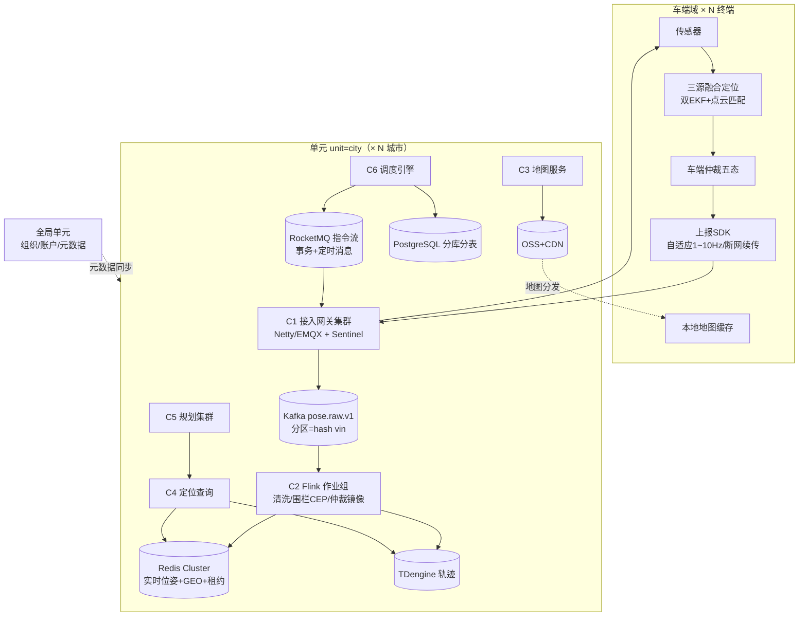

# 总体架构 · campus-nav 平台

> 本文档是平台的**权威总体架构**。分量设计见：[middleware.md](middleware.md)（中间件）、[contracts.md](contracts.md)（数据与接口契约）、[services/](services/)（域服务）、[vehicle-architecture.md](vehicle-architecture.md)（车端）、[adr.md](adr.md)（决策记录）。
> 版本：2026-10-25 v2（平台量级重构）

---

## 1. 系统定位与量级目标

校园低速自动驾驶车的导航定位平台：**车端实时定位系统 + 云端高并发位置服务平台**，按十万级终端的量级设计，对标美团 / 饿了么配送定位体系。

| 指标 | 设计容量 | 依据 |
| --- | --- | --- |
| 接入终端 | 10 万+ 长连接（可扩百万） | 网关无状态水平扩 |
| 位姿上报 | 峰值 50 万 msg/s | 自适应 1~10 Hz × 终端数 |
| 指令下发 | 峰值 5 万 TPS | 可靠投递 + 幂等 + 租约 |
| 实时围栏 / 就近查询 P99 | < 20 ms | Redis GEO |
| 位姿端到端时延（上报→可查询） | P99 < 1 s | 全链路预算见 §5 |
| 可用性 | 99.99% | 单元化多活 |
| 轨迹留存 | 热 90 天 + 冷归档 | 时序库 TTL + OSS |

**设计原则**（决策全文见 [adr.md](adr.md)）：

1. **车端自治优先**：弱网/断网本地闭环，云端是增强不是依赖
2. **单车有序、全局并行**：Kafka 分区 = hash(vin)，分区键是整个平台的骨干决策
3. **状态与历史分离**：实时状态进 Redis，轨迹进时序库，业务进分库分表
4. **单元化多活**：按城市 Set 化，单元内全链路闭环
5. **契约先行**：消息/接口全部版本化（topic `*.v1`、proto 包版本），先于代码冻结

---

## 2. 域划分

平台分两个交付域，本仓库同时承载：

| 域 | 技术 | 内容 | 目录 |
| --- | --- | --- | --- |
| **车端域** | ROS 2 Jazzy / C++17 / Python | 三源融合定位、降级仲裁、建图工具、规划网关客户端 | [vehicle/](../vehicle/) |
| **云端域** | JVM（Spring Cloud）/ Flink / gRPC | 接入网关、位姿管道、地图服务、定位查询、规划集群、调度引擎 | [cloud/](../cloud/) |

云端六个域服务：

| # | 服务 | 职责 | 设计文档 |
| --- | --- | --- | --- |
| C1 | 接入网关 gateway | 百万级长连接管理、鉴权限流、上下行编解码 | [services/01-gateway.md](services/01-gateway.md) |
| C2 | 位姿管道 pipeline | Kafka→Flink 清洗/围栏/仲裁镜像 → 多存储落库 | [services/02-pipeline.md](services/02-pipeline.md) |
| C3 | 地图服务 map-service | 地图资产、版本、CDN 分发、增量同步 | [services/03-map-service.md](services/03-map-service.md) |
| C4 | 定位查询 location-query | 实时位置 / 轨迹 / 就近查询 API | [services/04-location-query.md](services/04-location-query.md) |
| C5 | 规划集群 planning | 路径规划 / ETA，外部高德接入 | [services/05-planning.md](services/05-planning.md) |
| C6 | 调度引擎 dispatch | 任务-车辆匹配、派发租约、人工兜底 | [services/06-dispatch.md](services/06-dispatch.md) |

---

## 3. 总体拓扑

---

## 4. 关键全局决策（索引）

| # | 决策 | 一句话 | 全文 |
| --- | --- | --- | --- |
| ADR-001 | Kafka 分区键 = hash(vin) | 单车有序是定位正确性的底线，全局无序换来水平扩展 | [adr.md](adr.md) |
| ADR-002 | 双队列分工 | 数据流（Kafka）与指令流（RocketMQ 事务+定时）诉求不同，不混用 | [adr.md](adr.md) |
| ADR-003 | 车端自治优先，云端镜像对账 | 位置系统的可用性在端上，不在云上 | [adr.md](adr.md) |
| ADR-004 | 单元化按城市，分库分表键 = org_id | 单元内闭环 + 租户隔离路由一致 | [adr.md](adr.md) |
| ADR-005 | 状态/历史/业务三存储分离 | 读写模式完全不同，混用必致瓶颈 | [adr.md](adr.md) |
| ADR-006 | 指令幂等 = 单调 seq + 租约定时消息 | 可靠投递不靠重试堆砌，靠幂等与确定性超时 | [adr.md](adr.md) |
| ADR-007 | 坐标服务纯函数库 + 无状态服务双形态 | 车端内嵌零网络开销，云端弹性扩容 | [adr.md](adr.md) |
| ADR-008 | 契约全部版本化（proto + topic `*.v1`） | 契约先行于代码，滚动升级不锁步 | [adr.md](adr.md) |

---

## 5. 端到端时延预算（P99 < 1 s 的分解）

| 段 | 预算 | 手段 |
| --- | --- | --- |
| 车端采集 → 网关 | ≤ 100 ms | 自适应上报、批量合并帧 |
| 网关 → Kafka | ≤ 50 ms | 网关异步批量发送（linger 10ms / batch 64KB） |
| Kafka → Flink 处理 → Redis | ≤ 300 ms | Flink 端到端低延迟模式、Redis pipeline |
| Redis → 查询 API 返回 | ≤ 50 ms | GEO 查询 P99 < 20 ms 留余量 |
| 余量 | ≤ 500 ms | 覆盖 GC、重平衡、跨机房 RTT |

**超时预算的治理**：每段都有独立指标与告警（P99 分段监控），哪段劣化先于用户感知。

---

## 6. 数据流（三链路）

| 链路 | 模式 | 路径 | 产出 |
| --- | --- | --- | --- |
| 建图 | 离线批处理 | SLAM → RTK 锚点 → Helmert 对齐 → 场景标注 → C3 上传 | 地图三件套（RMSE < 0.15 m 准入） |
| 定位 | 实时流 | 车端三源融合 → SDK 上报 → C1 → pose.raw.v1 → C2 → Redis + TDengine | 50 Hz 位姿 + 1 Hz 状态 |
| 指令 | 事务流 | C6 调度 → RocketMQ 事务消息 → C1 下发 → 终端 ACK → 状态回写 | 可靠投递 + 幂等 |
| 规划 | 请求响应 | 任务/APP → C5 → 高德（外部）+ 车道图 → 参考路径 | navigationData |
| 地图分发 | 增量同步 | C3 → OSS/CDN → 车端拉取（分片断点续传） | 版本化地图 |

---

## 7. 与 storm-cloud 的关系

storm-cloud（车队运营平台 BFF）是本平台的**上游业务层**：组织/用户/权限/任务编排已在该仓库实现（75 接口契约）。本平台落地后：

- storm-cloud 的 `tasks/queue` 派发逻辑演进为 C6 调度引擎（中间件从 DB 轮询升级为 RocketMQ 定时消息）
- storm-cloud 的 `maps/*` 契约原样演进为 C3 地图服务
- storm-cloud 的 `nodes/location` 上报演进为 C1/C2 管道
- 对外 API 契约（信封、错误码、分页）保持不变

---

## 8. 演进路线（架构先行）

| 阶段 | 内容 | 出口判据 |
| --- | --- | --- |
| A0 架构设计 | 本文档集（总架构/中间件/契约/ADR/六服务设计）完成并评审 | 本仓库 docs/ 齐套 |
| A1 车端域 | campus_coord 闭合验证 → 建图 → 定位 → 规划（见 vehicle-architecture.md） | G1~G5 门 |
| A2 云端地基 | 本地中间件栈（deploy/）+ C1 网关 MVP + C2 管道 MVP | 千终端压测 P99 达标 |
| A3 平台化 | C3~C6、单元化、多活演练 | 10 万终端容量测试 |
